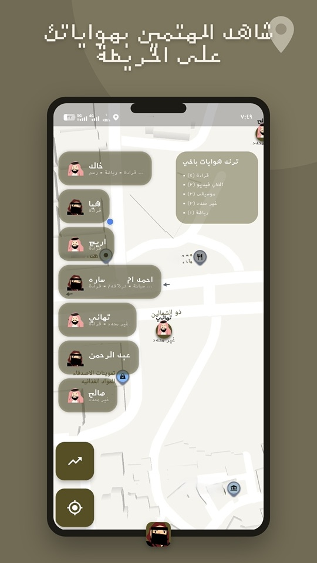
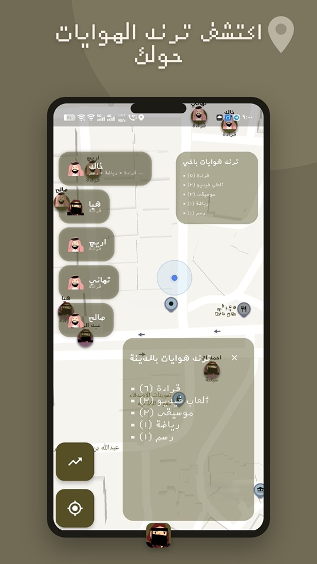
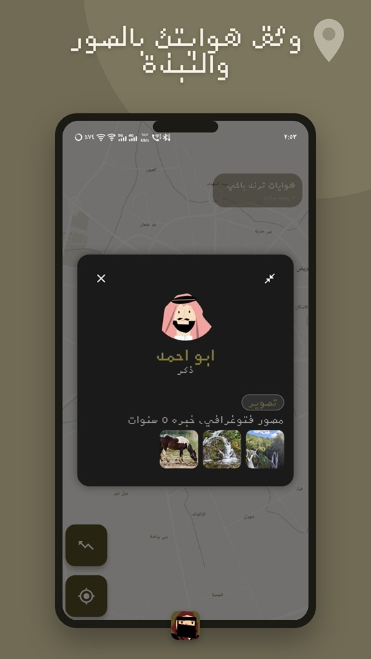
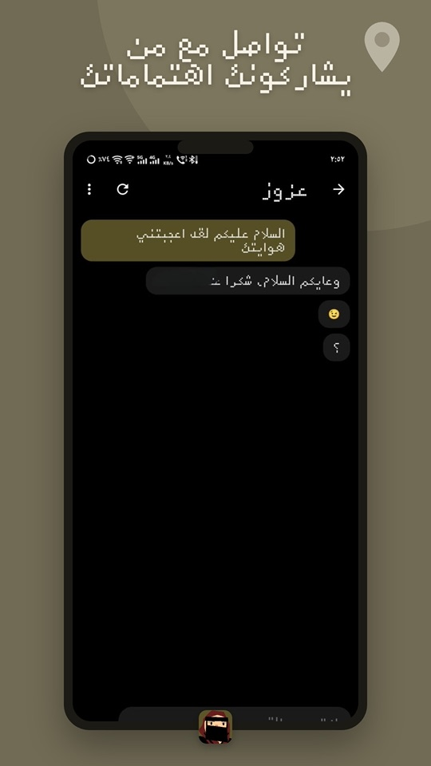
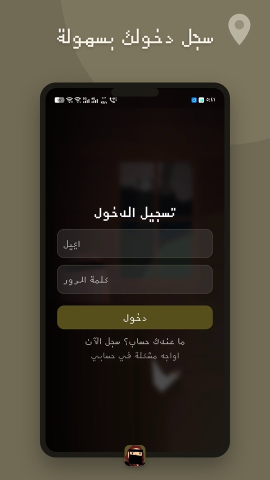
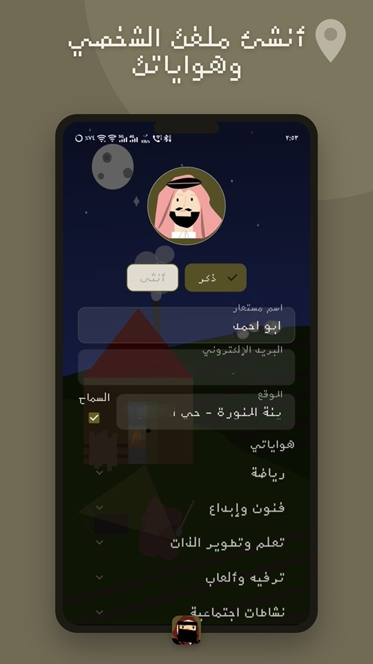
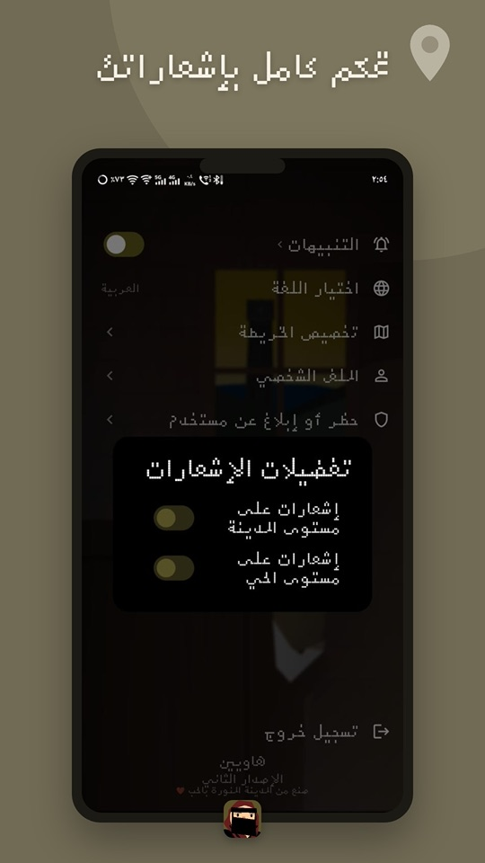
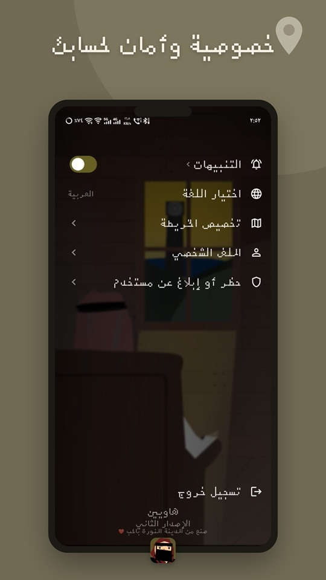
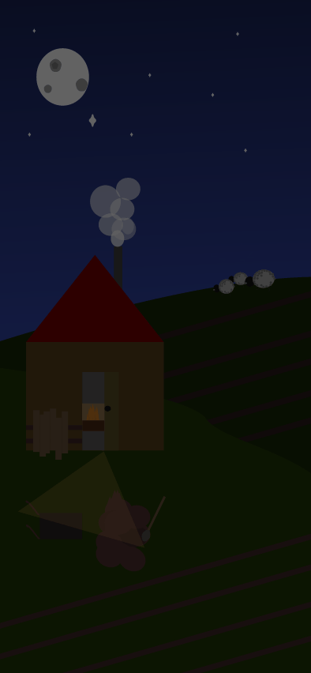
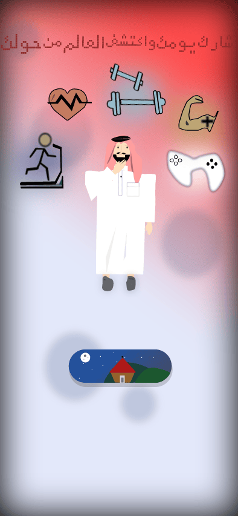

# هاويين &nbsp;|&nbsp; Hawyeen

### اكتشف هوايات جيرانك مجتمع الهوايات على الخريطة

  

   

 

<table align="center">
  <tr>
    <td align="center"></td>
    <td align="center"></td>
    <td align="center"></td>
    <td align="center"></td>
  </tr>
</table>

## ما هو هاويين؟

**هاويين** تطبيق اجتماعي يجمع الناس حول **هواياتهم**. تفتح الخريطة فتشوف من حولك من الهواة: أسماؤهم وهواياتهم، وما هي الهوايات الأكثر حضورًا في حيّك ومدينتك، ثم تتعرّف عليهم وتتواصل معهم.

تصميمه مبني على أنيميشن سلس بتقنية **Rive**، وخصوصيتك فيه أولًا: موقعك لا يظهر بدقة لأحد.

 

## المميزات

- **خريطة الهواة**: كل مستخدم يشارك موقعه يظهر باسمه وهواياته على الخريطة.
- **ترند الحي والمدينة**: اعرف أكثر الهوايات حضورًا حولك، وتتغير القائمة حسب المنطقة التي تتصفحها.
- **ملفك وهواياتك**: اختر حتى 3 هوايات من أكثر من 30 هواية موزعة على فئات، وأضف لكل هواية نبذة قصيرة وحتى 3 صور توثّقها.
- **طلبات تواصل ومحادثات**: أرسل طلب تواصل، وبعد القبول تبدأ محادثة بينكما.
- **إشعارات ذكية**: عند انضمام هاوٍ جديد في حيّك أو مدينتك، وعند وصول طلب تواصل أو رسالة.
- **أمان المجتمع**: إبلاغ وحظر للمستخدمين، وتحقق من البريد الإلكتروني عند التسجيل.
- **لغتان**: عربي وإنجليزي.

 

## الخصوصية أولًا

- **موقعك يُقرَّب قبل نشره** إلى منطقة بحجم كيلومتر تقريبًا، ولا يُعرض موقعك الدقيق لأي مستخدم.
- **البيانات العامة** هي فقط: الاسم المستعار، الجنس، الهوايات، والمنطقة التقريبية.
- **بريدك وإعدادات حسابك** خاصة بك ولا يراها أحد.
- **أنت المتحكم**: توقف مشاركة الموقع في أي وقت، ويمكنك حذف حسابك مع بياناتك.

 

## لقطات من التطبيق

<table align="center">
  <tr>
    <td align="center"> تسجيل الدخول</td>
    <td align="center"> الخريطة</td>
    <td align="center"> ترند الحي</td>
    <td align="center"> بطاقة الهواية</td>
  </tr>
  <tr>
    <td align="center"> الملف الشخصي</td>
    <td align="center"> المحادثات</td>
    <td align="center"> الإشعارات</td>
    <td align="center"> الإعدادات</td>
  </tr>
</table>

 

## أنيميشن في كل مكان

يعتمد التطبيق على أنيميشن **Rive** في شاشاته، لتجربة ممتعة وسلسة.

<table align="center">
  <tr>
    <td align="center"></td>
    <td align="center"></td>
  </tr>
</table>

 

## نسخة الويب

لمن لا يريد تحميل التطبيق، توجد لمحة مصغّرة منه على الويب: ادخل كضيف وشاهد الخريطة والهوايات والترند، أو سجّل دخولك بحسابك. وتدعم العربية والإنجليزية ونمطين للخريطة: داكن وكلاسيكي.

**[افتح نسخة الويب](https://vuvvvv.github.io/HawyeenApp/)**

 

## التقنيات

| الجزء | ما استخدمته |
|---|---|
| التطبيق | Flutter (Dart) |
| الخدمات | Firebase: Authentication, Firestore, Storage, Cloud Functions, Cloud Messaging |
| الخريطة | Google Maps، وتحميل المستخدمين حسب المنطقة المعروضة باستخدام Geohash |
| الأنيميشن | Rive |
| الويب | React + Vite، ويُستضاف على GitHub Pages |

 

## التحميل

متاح حاليًا في **المملكة العربية السعودية**، والمزيد من المدن قريبًا.

 

 

صُنع في المدينة المنورة بالحب ❤️ &nbsp;·&nbsp; [@vuvvvv](https://github.com/vuvvvv)

<b>English</b>

 

**Hawyeen** is a hobby community on a map. See who around you shares your hobbies, discover the most popular hobbies in your neighborhood and city, then connect and chat.

- Map of hobbyists with name and hobbies
- Neighborhood and city hobby trends
- Pick up to 3 hobbies and document each with a short bio and up to 3 photos
- Connection requests and chats, smart notifications, report and block
- Arabic and English
- **Privacy first:** your location is rounded to an area of about one kilometer before it is shared, and your exact location is never shown to anyone. Public data is only your nickname, gender, hobbies and approximate area.

Built with Flutter, Firebase and Rive. Available in Saudi Arabia, more cities coming soon.

[Google Play](https://play.google.com/store/apps/details?id=com.abdulaziz.hobbies) · [AppGallery](https://appgallery.huawei.com/app/C116746173) · [Web demo](https://vuvvvv.github.io/HawyeenApp/)

